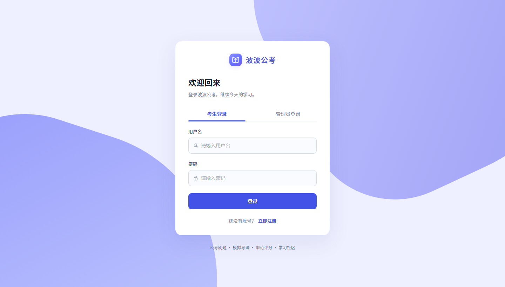
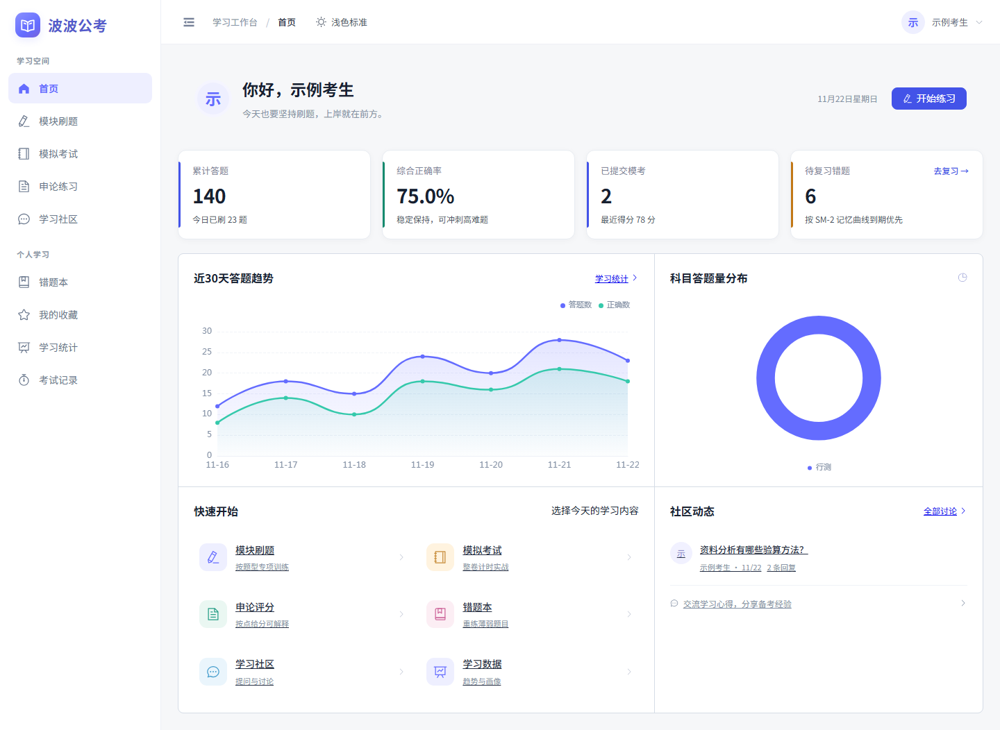

# 波波公考 - 快速启动指南

本文说明如何从仓库根目录启动项目。

## 系统要求

- Windows 10/11，使用 PowerShell 终端。
- JDK 21，`JAVA_HOME` 指向 JDK 安装目录，`java.exe` 可从 PATH 调用。
- Node.js 18+ 与 npm。
- MySQL 8，默认连接端口为 `13306`。Windows 服务名可按本机安装调整。
- 后端使用项目自带的 Maven Wrapper，在 `backend` 目录执行 `.\mvnw.cmd`。

可在 PowerShell 中检查环境。

```powershell
java -version
node --version
npm.cmd --version
$env:JAVA_HOME
```

## 一键启动

双击仓库根目录的 `一键启动.bat`，页面会自动打开。默认本机数据库的密码验证成功后会加密保存在当前 Windows 账户下，以后双击即可直接启动。

脚本通过 `start.ps1` 检查已有服务，并尝试启动已安装且处于停止状态的 MySQL 服务。后端需要启动时先构建 JAR，前端需要启动时检查并安装缺少的 Vite 依赖，随后等待前后端就绪。数据库启动需要管理员权限时，Windows 会显示权限确认，点击“是”继续。

已有服务正常时直接复用。启动期间再次运行会提示正在启动；其他服务占用 `18080` 或 `7401` 时会报告端口错误。前后端在后台运行，启动成功后窗口会自动关闭。

## 访问地址

| 用途 | 地址 |
| --- | --- |
| 登录及考生端 | [http://localhost:7401/](http://localhost:7401/) |
| 管理端 | [http://localhost:7401/admin](http://localhost:7401/admin) |
| 后端健康检查 | [http://localhost:18080/api/health](http://localhost:18080/api/health) |
| Swagger 接口文档 | [http://localhost:18080/swagger-ui.html](http://localhost:18080/swagger-ui.html) |
| OpenAPI JSON | [http://localhost:18080/api-docs](http://localhost:18080/api-docs) |

MySQL 默认使用 `localhost:13306`，数据库名称为 `honghu`。Vite 将 `/api` 请求代理到 `http://localhost:18080`。如使用其他端口，请同步设置 `HONGHU_DB_URL`。

## 登录账号

启动后，浏览器会打开以下登录页。刷题请选择“考生登录”，管理题库请选择“管理员登录”。



管理员用户名默认为 `admin`。首次启动时，`AdminInitializer` 会随机生成初始密码并在后端日志中提示，同时写入被 `.gitignore` 排除的 `ADMIN_CREDENTIALS.txt`。首次登录后请立即修改密码并删除该文件。不要将凭据提交到版本库。

普通考生可从登录页面的“立即注册”创建账号。注册用户名长度为 3–50 个字符，注册密码长度为 6–50 个字符。

管理员已存在时，启动流程使用数据库中的现有账号。同一账号重新登录会注销该账号之前的登录令牌。

## 界面与导航

登录和注册页面采用蓝紫主题。考生登录后进入学习首页，查看真实学习统计、答题图表、学习入口和最近社区讨论。桌面端通过左侧导航切换页面；手机端使用底部常用入口，或打开顶栏菜单抽屉访问申论、错题、收藏和考试记录等页面。管理端沿用同一视觉风格。

考试记录页区分未交卷和已交卷状态，点击“成绩摘要”查看得分、总分、实际用时和开始及交卷时间。



首次打开改版界面时按 Ctrl+F5 刷新，加载新的页面和样式。视觉参考见 [蓝紫学习工作台改版说明](docs/design/soybean-redesign.md)。

## 在 VS Code 中运行

在 VS Code 中打开仓库文件夹。手动启动前先执行停止脚本，释放前后端端口。

```powershell
.\停止服务.bat
```

确认 MySQL80 运行。服务处于停止状态时，可在管理员 PowerShell 中执行以下命令。

```powershell
Start-Service -Name MySQL80
```

打开两个 PowerShell 终端。后端终端执行以下命令。

```powershell
Set-Location .\backend
.\mvnw.cmd spring-boot:run
```

前端终端执行以下命令。

```powershell
Set-Location .\frontend
npm.cmd install
npm.cmd run dev
```

前端依赖已安装时，直接运行 `npm.cmd run dev`。前端源码和样式修改后，Vite 会更新页面；本次界面改版继续使用原有一键启动脚本和端口配置。修改 Java 代码后重启后端。默认使用 Caffeine 保存有效令牌，后端重启后需要重新登录，再刷新浏览器页面。

## 停止与日志

停止一键启动的前后端服务时，双击 `停止服务.bat`。在 VS Code 手动运行时，也可在相应终端按 Ctrl+C。

运行日志位于 `logs` 目录。

- `backend.log` 和 `backend-error.log` 记录后端运行输出。
- `frontend.log` 和 `frontend-error.log` 记录前端运行输出。
- Maven 构建和首次 npm 安装的输出显示在启动终端。

MySQL 由操作系统服务管理。数据库连接配置位于 `backend/src/main/resources/application.properties`，密码和 JWT 密钥通过环境变量提供。

## 新数据库环境的准备

在新的 MySQL 环境中先创建数据库，再设置连接环境变量。

```powershell
mysql.exe -P 13306 -u root -p
```

进入 MySQL 客户端后执行以下 SQL。

```sql
CREATE DATABASE IF NOT EXISTS honghu
CHARACTER SET utf8mb4 COLLATE utf8mb4_unicode_ci;
```

连接属性使用 `HONGHU_DB_URL`、`HONGHU_DB_USER` 和 `HONGHU_DB_PASSWORD`。JWT 密钥使用 `HONGHU_JWT_SECRET`，长度至少 32 字节。

后端启动时由 Flyway 执行 `backend/src/main/resources/db/migration` 下的数据库迁移。题库素材导入流程见 [README.md](README.md) 的数据导入部分。

## 常见问题

### npm 提示找不到 package.json

前端命令在 `frontend` 目录执行。

```powershell
Set-Location .\frontend
npm.cmd run dev
```

### 端口占用或权限拒绝

检查实际监听进程及 Windows 保留端口范围。

```powershell
Get-NetTCPConnection -State Listen | Where-Object { $_.LocalPort -in 7401, 18080, 13306 }
netsh interface ipv4 show excludedportrange protocol=tcp
netsh interface ipv6 show excludedportrange protocol=tcp
```

前端默认使用 `7401`，一键启动的后端使用 `18080`（单独运行 Spring Boot 时默认为 `8080`）。前端端口配置在 `frontend/vite.config.js`，数据库连接由 `HONGHU_DB_URL` 配置。

### 前端请求返回 500 或连接被拒绝

检查 `http://localhost:18080/api/health` 和后端日志。后端停止时，Vite 代理请求会失败，可重新执行一键启动恢复服务。

### 管理员登录失败

选择“管理员登录”，使用首次启动生成的管理员密码。密码修改或同一账号再次登录后，需要重新登录获取有效令牌。

### 更新后学习统计或社区内容没有显示

后端代码更新后，先重新构建并启动后端，再重新登录和刷新页面。一键启动会复用已运行的服务，因此需要先停止服务，再启动才能加载新的后端代码。

学习统计图表会在页面容器就绪后绘制；无答题记录时显示“暂无答题数据”。页面统计包括累计作答、正确率、答错次数与已提交考试数。社区列表和详情按后端记录读取，发帖或回复成功后刷新内容。当前功能与尚未支持的管理操作见 [README.md](README.md)。

图表会随容器大小自动调整；科目正确率在一至两个科目时使用条形图，三个及以上科目时使用雷达图。仅前端样式或页面更新时，先按 Ctrl+F5 刷新，不需要为此改动数据库或启动配置。

### 后端构建失败

检查 JDK 21、`JAVA_HOME` 和启动终端的 Maven 输出。

```powershell
Set-Location .\backend
.\mvnw.cmd -version
.\mvnw.cmd package -DskipTests
```

更详细的启停和日志说明见 [启动说明.md](启动说明.md)。当前功能与页面接口对齐事项见 [README.md](README.md)。
