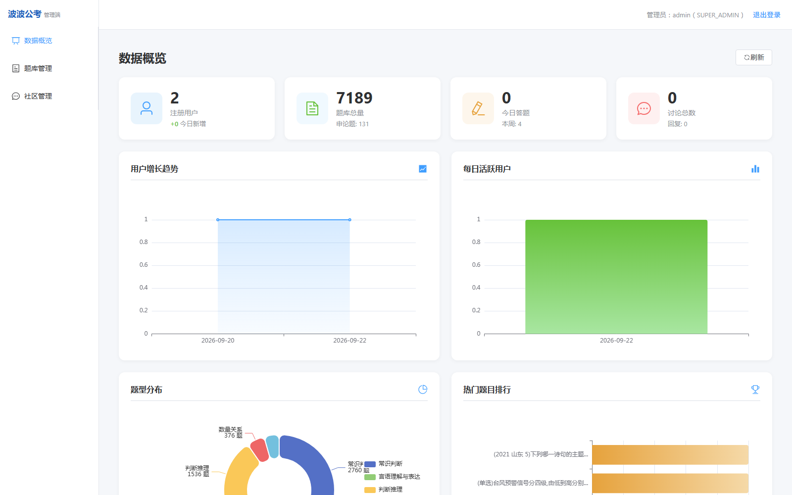

# 波波公考 (HongHu) - 公务员考试练习系统

<div align="center">


**一个全功能的公务员考试在线学习平台**

支持刷题练习 | 模拟考试 | 申论批改 | 错题本 | 学习统计 | 讨论社区

[功能特性](#功能特性) • [技术栈](#技术栈) • [快速开始](#快速开始) • [项目结构](#项目结构) • [开发指南](#开发指南)

</div>

---

## 📋 功能特性

### 用户端功能
- **智能刷题** - 7000+ 真题题库，支持按科目、题型、难度筛选
- **模拟考试** - 真实考场环境模拟，自动计时评分
- **申论批改** - AI 辅助批改申论题，智能评分与改进建议
- **错题本** - 自动收录错题，针对性复习
- **收藏夹** - 标记重点题目，快速回顾
- **学习统计** - 可视化学习数据，掌握学习进度
- **讨论社区** - 题目讨论、经验分享

### 管理端功能
- **题库管理** - 题目增删改查，批量导入导出
- **数据概览** - 用户增长、答题统计、热门题目分析
- **社区管理** - 讨论内容审核、置顶推荐


*管理端数据概览 - 实时统计 7189 道题库、用户活跃度、题型分布*

---

## 🛠 技术栈

### 后端
- **Java 21** + **Spring Boot 3.3.3** - 现代化 Java 开发框架
- **MyBatis 3.0.3** - 持久层框架，灵活的 SQL 映射
- **Flyway** - 数据库版本管理与迁移
- **MySQL 8** - 关系型数据库
- **JWT** (jjwt 0.12.6) - 无状态身份认证
- **Caffeine + Redis** - 多级缓存策略
- **SpringDoc OpenAPI** - 自动生成 Swagger 接口文档

### 前端
- **Vue 3** + **Vite 5** - 轻量高效的现代前端工具链
- **Element Plus** - 企业级 UI 组件库
- **Pinia** - 官方状态管理方案
- **Vue Router** - SPA 路由管理
- **ECharts** - 数据可视化图表
- **Axios** - HTTP 请求库
- **PWA** - 渐进式 Web 应用支持

### 开发工具
- **Maven** - 依赖管理与构建
- **npm** - 前端包管理

---

## 🚀 快速开始

### 环境要求
- **Java 21+** (推荐 OpenJDK 或 Oracle JDK)
- **Node.js 18+** + npm
- **MySQL 8.0+**
- **Git**

### 1. 克隆项目
```bash
git clone https://github.com/123klh/honghu.git
cd honghu
```

### 2. 数据库准备
```sql
CREATE DATABASE honghu CHARACTER SET utf8mb4 COLLATE utf8mb4_unicode_ci;
```

### 3. 配置后端
编辑 `backend/src/main/resources/application.properties`：
```properties
spring.datasource.url=jdbc:mysql://localhost:3306/honghu?useSSL=false&serverTimezone=Asia/Shanghai&characterEncoding=utf8&useUnicode=true
spring.datasource.username=root
spring.datasource.password=YOUR_PASSWORD

jwt.secret=YOUR_SECRET_KEY_AT_LEAST_32_CHARS_CHANGE_IN_PRODUCTION
```

### 4. 启动项目

#### Windows 一键启动
```bash
# 双击 一键启动.bat
# 或在 CMD 中执行：
一键启动.bat
```

#### 手动启动
```bash
# 后端
cd backend
./mvnw clean package -DskipTests
java -jar target/honghu-backend-1.0.1.jar

# 前端（新窗口）
cd frontend
npm install
npm run dev
```

### 5. 访问系统
- **前端首页**: http://localhost:5173
- **后端 API**: http://localhost:8080
- **Swagger 文档**: http://localhost:8080/swagger-ui.html

### 6. 登录凭证
首次启动后，系统会自动初始化超级管理员账户，凭证保存在：
```
backend/ADMIN_CREDENTIALS.txt
```

默认测试用户（若数据库已有种子数据）：
- 用户名: `konglinghao`
- 密码: 见数据库或自行注册

---

## 📂 项目结构

```
honghu/
├── backend/                    # Spring Boot 后端
│   ├── src/main/java/com/honghu/
│   │   ├── controller/        # REST API 控制器
│   │   ├── service/           # 业务逻辑层
│   │   ├── mapper/            # MyBatis Mapper 接口
│   │   ├── pojo/              # 实体类 (POJO)
│   │   ├── common/            # 通用组件（Result、分页等）
│   │   ├── auth/              # 认证鉴权（JWT、拦截器）
│   │   ├── annotation/        # 自定义注解
│   │   └── init/              # 启动初始化逻辑
│   ├── src/main/resources/
│   │   ├── mapper/            # MyBatis XML 映射文件
│   │   ├── db/migration/      # Flyway 数据库迁移脚本
│   │   └── application.properties
│   ├── mvnw / mvnw.cmd        # Maven Wrapper
│   └── pom.xml
├── frontend/                   # Vue 3 前端
│   ├── src/
│   │   ├── views/             # 页面组件
│   │   │   ├── user/          # 用户端页面
│   │   │   └── admin/         # 管理端页面
│   │   ├── components/        # 可复用组件
│   │   ├── router/            # 路由配置
│   │   ├── store/             # Pinia 状态管理
│   │   ├── api/               # API 请求封装
│   │   └── assets/            # 静态资源
│   ├── public/                # 公共文件
│   ├── package.json
│   └── vite.config.js
├── docs/                       # 文档与截图
│   └── screenshots/
├── 一键启动.bat                # Windows 快速启动脚本
├── 停止服务.bat                # Windows 停止服务脚本
└── README.md
```

---

## 💻 开发指南

### 后端开发
```bash
cd backend

# 编译打包
./mvnw clean package

# 跳过测试快速打包
./mvnw clean package -DskipTests

# 运行测试
./mvnw test

# 本地调试运行
./mvnw spring-boot:run
```

### 前端开发
```bash
cd frontend

# 安装依赖
npm install

# 开发模式（热重载）
npm run dev

# 生产构建
npm run build

# 预览生产构建
npm run preview

# 代码检查
npm run lint
```

### 数据库迁移
Flyway 会在启动时自动执行 `src/main/resources/db/migration/` 下的迁移脚本。

手动执行迁移（如需）：
```bash
./mvnw flyway:migrate
./mvnw flyway:info      # 查看迁移状态
./mvnw flyway:repair    # 修复校验和不匹配
```

### API 文档
启动后端后访问 Swagger UI：
```
http://localhost:8080/swagger-ui.html
```

---

## 🎯 核心功能说明

### 题库系统
- **数据来源**: 真实公务员考试历年真题 + 模拟题
- **题型覆盖**: 
  - 判断推理（1536 题）
  - 常识判断（2760 题）
  - 言语理解与表达（2200 题）
  - 数量关系（376 题）
  - 资料分析（317 题）
  - 申论题（131 题）

### 智能推荐
- 基于答题记录的错题回顾
- 薄弱知识点针对性训练
- 历史正确率统计

### 统计分析
- 用户增长趋势
- 每日活跃度
- 题型分布饼图
- 热门题目排行
- 个人学习轨迹

---

## 🔒 安全说明

本项目采用以下安全措施：
- JWT 令牌认证，无状态会话
- 密码 BCrypt 哈希存储
- SQL 注入防护（MyBatis 预编译）
- XSS 防护（前端输入校验）
- CORS 跨域控制
- 角色权限控制（用户/管理员）

**生产部署前请务必**：
1. 修改 `jwt.secret` 为强随机密钥（≥32 字符）
2. 修改数据库密码为强密码
3. 启用 HTTPS
4. 配置防火墙规则
5. 定期备份数据库

---

## 📊 数据统计

当前题库规模：
- **选择题**: 7189 道
- **申论题**: 131 道
- **试卷**: 88 套
- **覆盖科目**: 5 大类

---

## 🤝 贡献指南

欢迎提交 Issue 和 Pull Request！

1. Fork 本仓库
2. 创建特性分支 (`git checkout -b feature/AmazingFeature`)
3. 提交更改 (`git commit -m 'Add some AmazingFeature'`)
4. 推送到分支 (`git push origin feature/AmazingFeature`)
5. 提交 Pull Request

---

## 📄 开源协议

本项目采用 [MIT License](LICENSE) 开源协议。

---

## 📞 联系方式

- **项目主页**: https://github.com/123klh/honghu
- **问题反馈**: https://github.com/123klh/honghu/issues

---

## 🙏 致谢

感谢所有开源社区贡献的优秀项目：
- Spring Boot Team
- Vue.js Team
- Element Plus Team
- MyBatis Team
- 以及所有依赖项的维护者

---

**⭐ 如果这个项目对你有帮助，请给个 Star 支持一下！**
