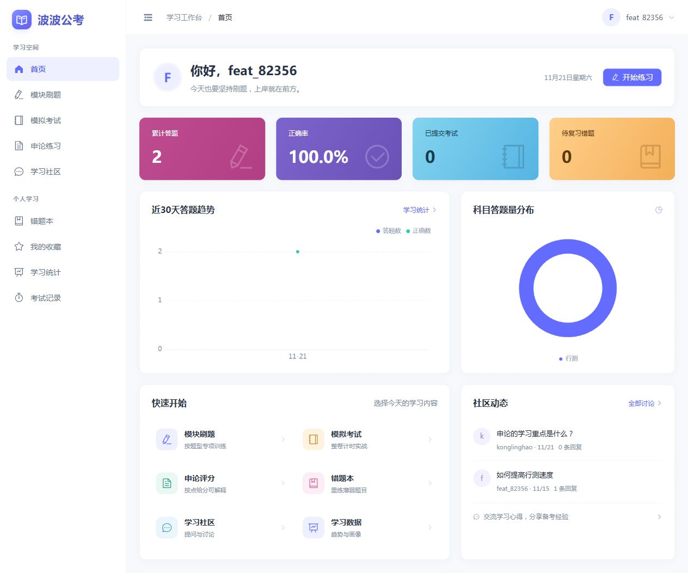
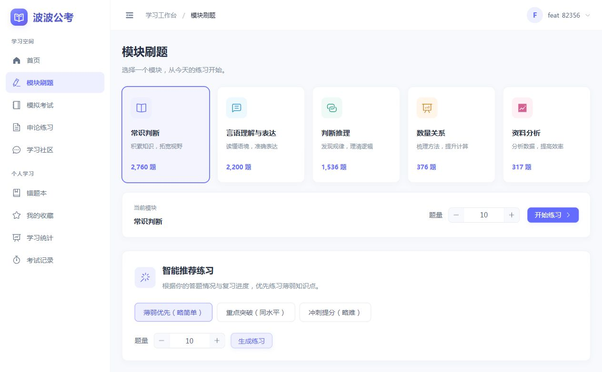
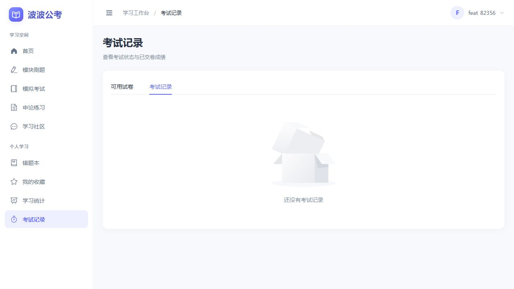
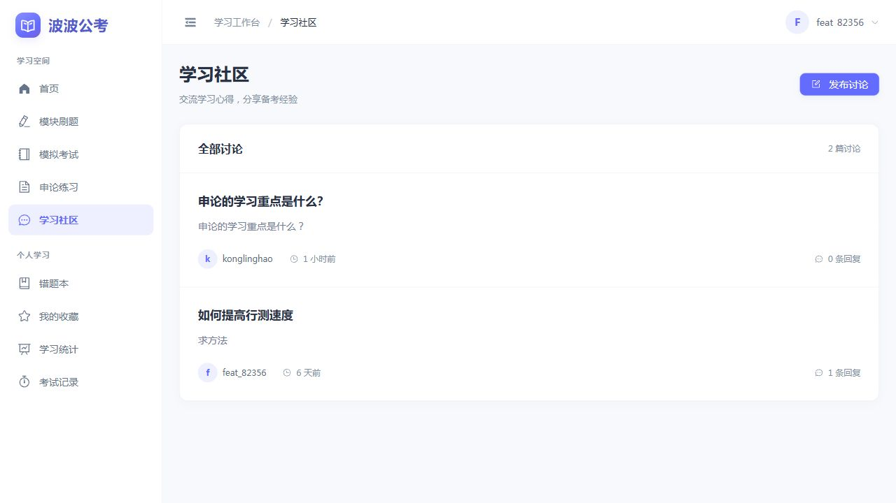
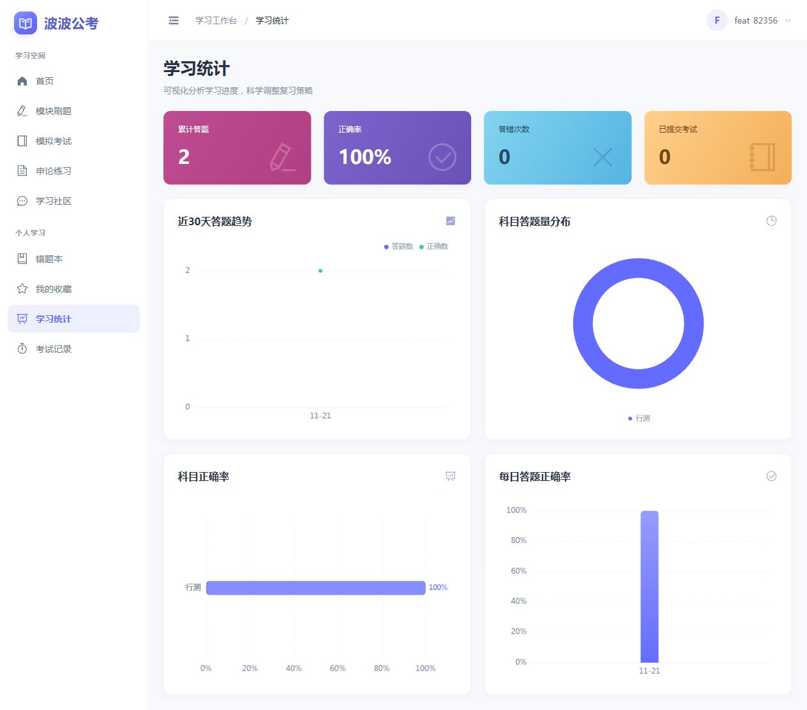
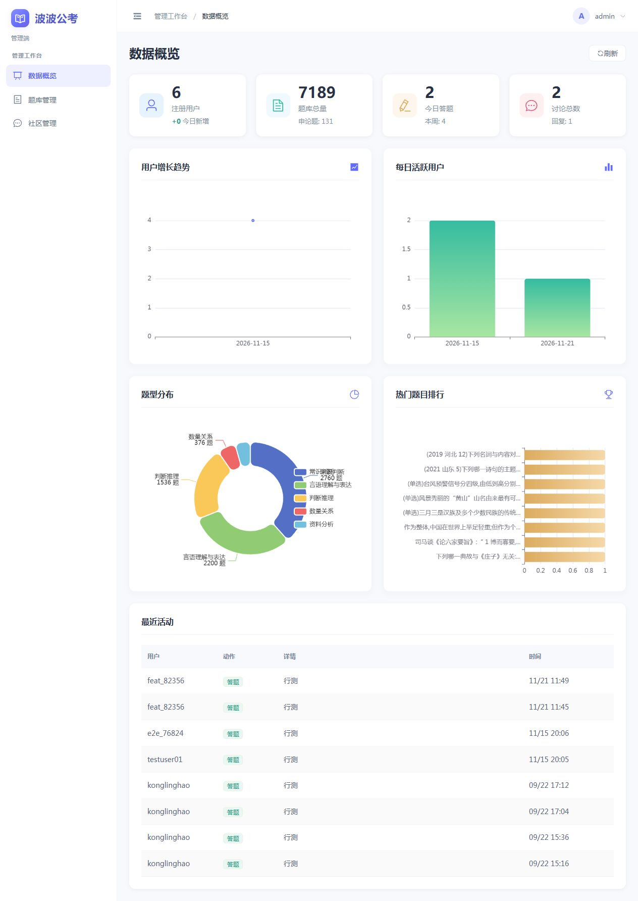

# 波波公考项目介绍

> 基于 Spring Boot 和 Vue 的公务员考试在线学习与刷题系统
>
> 作者：123klh
>
> 项目地址：https://github.com/123klh/honghu

## 1. 项目概述

“波波公考”面向准备公务员考试的学习者，提供行测专项练习、模拟考试、申论练习、错题与收藏、学习统计和讨论社区。系统同时提供管理端，用于查看平台数据、维护题库和管理社区内容。

项目采用 B/S 架构和前后端分离方式。Vue 单页应用通过 REST/JSON 接口访问 Spring Boot 后端，MySQL 保存用户、题目、作答、考试和社区数据。

### 项目目标

- 将行测各模块的日常刷题、解析和错题复习集中到一个学习工作台。
- 通过模拟考试和考试记录帮助学习者进行整套训练。
- 通过学习统计呈现作答量、正确率、科目分布和每日趋势。
- 通过申论材料、作答和要点匹配评分提供可重复的练习反馈。
- 为管理员提供题库、用户、社区和学习活动的基础运营视图。

## 2. 技术架构

| 层次 | 技术与职责 |
| --- | --- |
| 前端 | Vue 3、Vite 5、Element Plus、Pinia、Vue Router、Axios、ECharts、PWA |
| 后端 | Java 21、Spring Boot 3.3.3、MyBatis、PageHelper，按 Controller、Service、Mapper 分层 |
| 数据库 | MySQL 8，Flyway V1–V4 迁移管理结构、触发器、基础种子和考试快照 |
| 认证 | JWT、BCrypt、角色校验；有效令牌默认由 Caffeine 保存，也可切换 Redis |
| 学习算法 | IRT/Elo 能力与题目难度更新，结合 SM-2 到期复习生成智能推荐 |
| 工具链 | Windows PowerShell、Maven Wrapper、npm、Python 导入器 |

## 3. 用户端功能

### 登录与学习工作台

用户可以注册考生账号，登录后进入学习首页。首页集中展示累计答题、正确率、已提交考试、待复习错题、近 30 天答题趋势、科目分布和社区动态。桌面端使用左侧导航，移动端提供常用底栏和完整导航抽屉。


*图 1　考生登录页面。*



*图 2　学习首页及统计卡片。*

### 行测专项练习

专项练习覆盖常识判断、言语理解与表达、判断推理、数量关系和资料分析五类模块。用户可以选择题量，进入作答流程，提交后查看判题结果、正确答案和解析。

系统提供三种智能推荐模式：

- 薄弱优先，优先覆盖能力较弱或近期错误较多的知识点。
- 重点突破，选择相近难度和知识点进行集中训练。
- 冲刺提分，结合复习到期题目和能力估计安排练习。



*图 3　专项练习模块选择和智能推荐入口。*

### 模拟考试与考试记录

用户可以从可用试卷中选择模拟考试，按计时流程完成作答并交卷。考试记录区分未交卷和已交卷状态，已交卷记录显示成绩摘要、总分、实际用时和时间信息。当前界面提供考试记录列表，逐题成绩详情接口仍待补充。



*图 4　考试记录页面空态。*

### 申论练习

申论页面展示题目、材料和作答区域。评分服务在本地对参考答案要点进行匹配，返回总分、命中要点和维度提示，适合用于练习后的快速反馈。评分结果属于规则匹配结果，不能替代人工阅卷。

### 错题、收藏与社区

错题本支持按题型浏览和复习。收藏页面支持题型过滤、分页、笔记保存和取消收藏。学习社区支持讨论发布、回复和详情浏览，提交后会刷新列表或详情。



*图 5　学习社区讨论列表。*

## 4. 学习统计

统计页提供累计作答、正确率、答错次数和已提交考试数，并以图表呈现：

- 近 30 天答题趋势。
- 按实际作答题数计算的科目答题量分布。
- 各科目真实答对数除以作答数得到的正确率。
- 每日答对次数除以作答次数得到的每日正确率。

没有作答记录时，页面会显示明确的空数据提示。科目正确率只有一至两个科目时使用条形图，三个及以上科目时使用雷达图。图表会随容器大小自动调整。



*图 6　学习统计页的四类图表。*

## 5. 管理端

管理员可以查看注册用户数、题库总量、今日答题和讨论总数，并浏览用户增长、活跃度、题型分布、热门题目和最近活动。题库管理支持检索和维护，社区管理支持讨论浏览、置顶或取消置顶和删除讨论。



*图 7　管理端数据概览。*

当前管理端仍有两项接口级限制：删除回复和按置顶状态筛选缺少后端支持。前端提供的申论年份、地区筛选控件也需要继续与后端参数契约对齐。

## 6. 数据与导入

源码中的 V1 创建数据库结构，V2 创建触发器和过程，V3 仅播种知识点树、公告和倒计时，V4 增加考试快照与重算逻辑。迁移不包含完整题库，题库内容需要根据授权素材另行导入，公开仓库不应把本机导入题量作为自带数据承诺。

项目提供 `tools/importer` 导入工具链，覆盖 PDF 提取、题目解析、数据规范化、MySQL 加载和申论评分要点生成。正式导入前应核对素材授权、题目覆盖范围、目标数据库和环境变量。导入缓存和诊断产物不属于发布源码。

本机题库数据由单独的授权素材导入流程生成，数据库迁移不会自动生成完整的行测题、申论题和试卷数据。

## 7. 运行方式

### 环境要求

- Windows 10/11 与 PowerShell 7。
- JDK 21，`JAVA_HOME` 指向 JDK 21。
- Node.js 18+ 与 npm。
- MySQL 8，创建 `honghu` 数据库并按目标环境填写连接信息。

### 一键启动

```powershell
$ProjectRoot = '项目目录完整路径'
Set-Location $ProjectRoot
.\一键启动.bat
```

默认地址如下：

- 用户端：http://localhost:7401/
- 管理端：http://localhost:7401/admin
- 健康检查：http://localhost:8080/api/health
- Swagger：http://localhost:8080/swagger-ui.html
- OpenAPI：http://localhost:8080/api-docs

### 构建检查

```powershell
$ProjectRoot = '项目目录完整路径'
Set-Location (Join-Path $ProjectRoot 'frontend')
npm.cmd install
npm.cmd run build

Set-Location (Join-Path $ProjectRoot 'backend')
.\mvnw.cmd package -DskipTests
```

前端图表数据口径检查可以运行 `node.exe frontend/tools/check-learning-charts.mjs`。后端重启后默认 Caffeine 令牌存储会清空有效令牌，需要重新登录。

## 8. 安全与公开发布说明

公开部署时必须通过环境变量或私有配置提供数据库密码、JWT 签名密钥和其他部署参数。管理员本机凭据、日志、构建产物、会话探针、导入缓存和个人素材目录不应提交到公开仓库。

项目使用 JWT 和 BCrypt，服务端登记有效令牌并支持注销，同一账号再次登录会使旧令牌失效。数据库参数通过 MyBatis 绑定，页面文本使用 Vue 文本绑定展示。

## 9. 当前状态与后续方向

当前版本已完成主要用户端与管理端流程、蓝紫学习工作台改版、响应式布局、统计图表和接口字段对齐。后续可以继续完善以下内容：

- 增加考试记录逐题成绩详情接口。
- 补齐管理端回复删除和置顶筛选后端支持。
- 完成申论年份、地区筛选参数对齐。
- 完成非空错题复习流程和社区点赞、采纳操作的完整回归验证。
- 持续补充更多题库导入样例和更细粒度的学习反馈。

## 10. 开源协议

项目采用 MIT License，许可证署名为仓库所有者 `123klh`，并保留依赖项目要求的第三方许可证声明。

